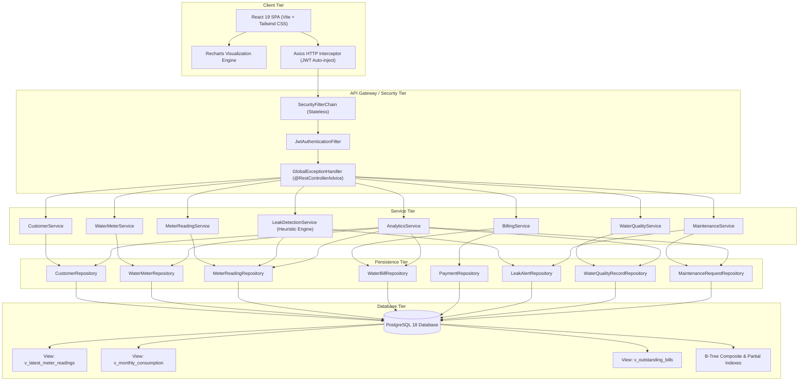

# System Architecture Specification

## 1. Architectural Principles & Patterns

The **Smart Water Management & Database Analytics System** adheres to modern enterprise software architecture principles:

1. **Separation of Concerns (SoC)**: Strict layering isolates presentation (React), REST controllers, application services, domain models, and persistence repositories.
2. **DTO & Information Hiding**: JPA entities are strictly confined within the service and repository boundary. No JPA entities are ever returned across HTTP endpoints. All ingress and egress payloads use strictly typed Data Transfer Objects (DTOs) with Jakarta Bean Validation (`@Valid`, `@NotNull`, `@Min`, `@Size`).
3. **Transactional Integrity**: All business mutating operations are wrapped in Spring `@Transactional` boundaries, ensuring ACID compliance and rollbacks on unchecked exceptions.
4. **N+1 Prevention**: Bidirectional JPA relationships and join queries utilize Spring Data JPA `@EntityGraph(attributePaths = {...})` or projection DTOs to eliminate secondary roundtrips to PostgreSQL.
5. **Stateless Security**: Spring Security 6 provides stateless authentication via signed HMAC-SHA256 JSON Web Tokens (JWT). Roles (`ADMIN`, `OPERATOR`, `TECHNICIAN`, `ANALYST`) enforce role-based access control (RBAC).

---

## 2. Component Architecture

---

## 3. Data Flow Pipelines

### 3.1 Meter Reading Ingestion & Consumption Calculation
1. **Payload Receipt**: REST client sends `POST /api/readings` with `meterId`, `cumulativeReadingM3`, and `readingTimestamp`.
2. **Meter Validation**: `MeterReadingServiceImpl` verifies meter existence and ensures status is not `RETIRED` or `REMOVED`.
3. **Cumulative Monotonicity Check**:
   - Fetches the immediately preceding reading for the meter.
   - If current reading < previous reading and `meterReset` flag is false: rejects with `BusinessRuleViolationException` (HTTP 422).
   - If `meterReset` is true: resets baseline and flags the reading for supervisory inspection.
4. **Window Delta Calculation**: Incremental consumption is calculated as:
   $$\Delta Consumption = Cumulative_{current} - Cumulative_{previous}$$
5. **Autonomous Leak Scan Trigger**: If $\Delta Consumption > 250\%$ of historical mean or continuous nocturnal flow is detected, an alert is automatically dispatched to `leak_alerts`.

### 3.2 Tariff Billing & Payment Lifecycle
1. **Invoice Generation**: Utility operator issues `POST /api/bills/generate` for a customer and billing cycle.
2. **Consumption Aggregation**: System queries cumulative meter readings within `[billingPeriodStart, billingPeriodEnd]`.
3. **Simulated Tariff Model**:
   - Base Fixed Meter Fee: $BaseFee$ (e.g. ¥1,500)
   - Volumetric Consumption: $Charge = Consumption_{m^3} \times Rate$ (e.g. ¥180 / m³)
   - Municipal Tax: $Tax = (BaseFee + Charge) \times 10\%$
   - Total Invoiced: $Total = BaseFee + Charge + Tax$
4. **Payment Recording**:
   - When payment is received, `BillingServiceImpl` validates that payment amount $\le$ `outstandingBalance`.
   - Transitions bill status: `ISSUED` $\rightarrow$ `PARTIALLY_PAID` $\rightarrow$ `PAID`.
