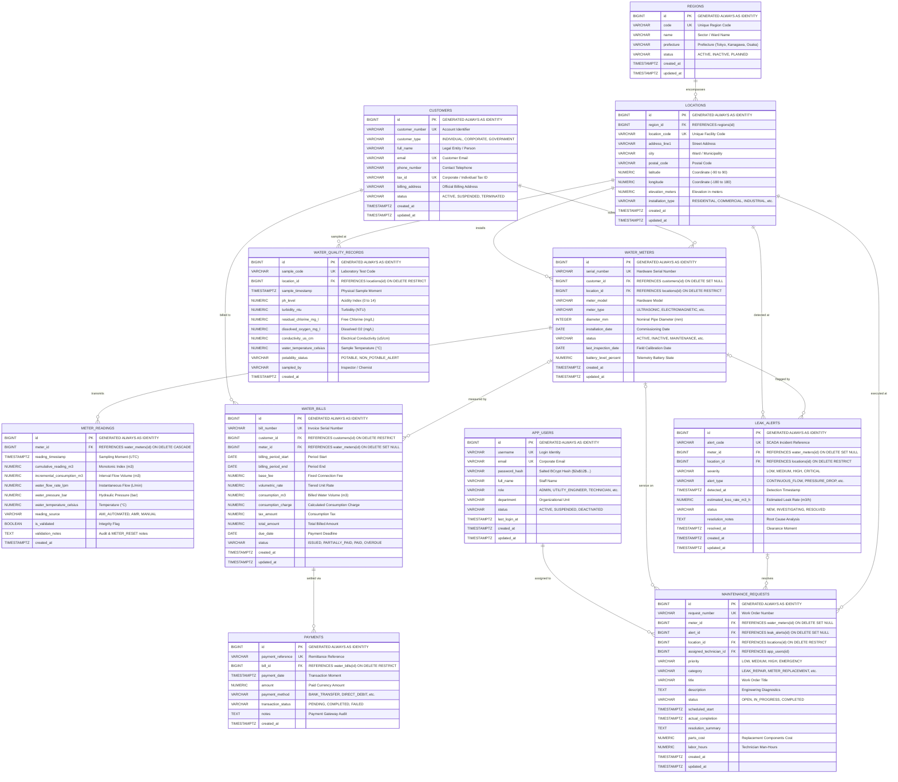

# Module 2: Advanced PostgreSQL Database Engineering Specification
## Smart Water Management System (Simulated Japanese Municipal Water Utility)

---

## 1. Entity-Relationship (ER) Architecture Diagram



---

## 2. Relational Normalization & Design Decisions

### 1NF (First Normal Form)
- All columns contain atomic, non-decomposable values. No CSV lists, arrays, or repeating groups are stored for telemetry readings, payments, or locations.
- Every table is enforced with an immutable `BIGINT GENERATED ALWAYS AS IDENTITY` primary key.

### 2NF (Second Normal Form)
- No non-key attribute is dependent on a fraction of a composite key.
- Natural multi-attribute business identities (e.g., `meter_id + reading_timestamp`) are protected via `UNIQUE` constraints (`uq_meter_reading_timestamp`), while synthetic identity keys optimize indexing and foreign key constraints across large-scale timeseries.

### 3NF & Boyce-Codd Normal Form (BCNF)
- **Separation of Physical Locations and Legal Customers**:
  - A customer can own or occupy multiple properties (e.g., a corporate client with both a manufacturing plant and a corporate headquarters).
  - A physical location persists regardless of customer turnover (meters remain installed while tenants change).
  - Eliminates transitive dependencies: Geographical attributes (`prefecture`, `city`, `postal_code`, `elevation_meters`, `latitude`, `longitude`) depend solely on `locations` and `regions`, never duplicated in `customers` or `water_meters`.
- **Decoupled Billing & Payment Ledger**:
  - `water_bills` and `payments` are strictly split to enable 1:M relationships (partial payments, installment settlements, multi-method remittances).
  - Outstanding balances and delinquency aging are computed dynamically or via analytical views (`v_outstanding_bills`) rather than stored redundantly in mutable customer balances, eliminating data divergence bugs.
- **Auditable Security**:
  - Passwords are strictly stored as salted BCrypt hashes (`password_hash VARCHAR(255)`), preventing plain-text credential leaks.

---

## 3. Business Integrity Constraints & Automated Triggers

### Monotonic Meter Reading Trigger (`fn_validate_meter_reading`)
In municipal water metering, cumulative index registers (`cumulative_reading_m3`) must increase monotonically over time.
- **Normal Flow**: When a new reading is inserted, the trigger automatically computes `incremental_consumption_m3 = NEW.cumulative_reading_m3 - PREVIOUS.cumulative_reading_m3`.
- **Negative Reading Trap**: If `NEW.cumulative_reading_m3 < PREVIOUS.cumulative_reading_m3`, the trigger throws a `check_violation` exception with error message:
  ```text
  Integrity Violation: Cumulative meter reading decreased from X m3 to Y m3 for Meter ID Z without authorized METER_RESET flag in validation_notes
  ```
- **Authorized Reset & Rollover**: If a meter rolls over past 99999.999 m3 or is physically replaced with a zeroed transducer, passing `METER_RESET` or `ROLLOVER` inside `validation_notes` permits the decrement and safely re-baselines the incremental consumption.

---

## 4. Analytical Views

### 1. `v_latest_meter_readings`
Combines meter hardware properties, customer demographics, and physical location coordinates with the single latest reading using window partition ordering:
```sql
ROW_NUMBER() OVER (PARTITION BY r.meter_id ORDER BY r.reading_timestamp DESC) = 1
```
Computes `hours_since_last_reading` to detect AMI communication dropouts.

### 2. `v_monthly_consumption`
Aggregates meter readings across calendar months, providing:
- Total consumed volume in cubic meters ($m^3$)
- Average and peak instantaneous flow rate ($L/min$)
- Minimum, maximum, and average hydraulic pressure ($bar$)

### 3. `v_outstanding_bills`
Monitors all uncollected utility revenue:
- Total billed vs total paid via completed transactions
- `outstanding_balance = total_amount - total_paid`
- `days_overdue = GREATEST(0, CURRENT_DATE - due_date)`
- Filtered using `HAVING outstanding_balance > 0.00`

---

## 5. Backup & Restore Runbook (Windows PowerShell)

The platform includes a dedicated PowerShell script [database/scripts/backup-restore.ps1](file:///c:/Users/dell/Desktop/veloia/database/scripts/backup-restore.ps1).

### Full Database Backup (Custom Binary Format -Fc)
```powershell
powershell -ExecutionPolicy Bypass -File database\scripts\backup-restore.ps1 -Action backup -Format custom
```
Creates a compressed archive in `database/backups/smart_water_management_YYYYMMDD_HHMMSS.dump`.

### Database Restore
```powershell
powershell -ExecutionPolicy Bypass -File database\scripts\backup-restore.ps1 -Action restore -BackupFile database\backups\<filename>.dump
```

### Table & View Inventory Verification
```powershell
powershell -ExecutionPolicy Bypass -File database\scripts\backup-restore.ps1 -Action verify
```

---

## 6. How to Run Migrations on a Fresh Database

To initialize and run all migrations on a clean PostgreSQL server:

1. **Create the Database**:
   ```powershell
   $env:PGPASSWORD="postgres"
   psql -U postgres -h localhost -c "CREATE DATABASE smart_water_management WITH OWNER postgres ENCODING 'UTF8';"
   ```

2. **Execute Flyway Migrations in Order**:
   ```powershell
   $env:PGPASSWORD="postgres"
   psql -U postgres -h localhost -d smart_water_management -f database\migrations\V1__initial_schema.sql
   psql -U postgres -h localhost -d smart_water_management -f database\migrations\V2__smart_water_schema.sql
   psql -U postgres -h localhost -d smart_water_management -f database\migrations\V3__indexes_and_views.sql
   psql -U postgres -h localhost -d smart_water_management -f database\migrations\V4__triggers_and_validation.sql
   psql -U postgres -h localhost -d smart_water_management -f database\seeds\R__sample_japanese_utility_seed.sql
   ```

3. **Execute Data Validation Suite**:
   ```powershell
   psql -U postgres -h localhost -d smart_water_management -f database\scripts\validate-data.sql
   ```

4. **Execute Advanced Analytics Suite**:
   ```powershell
   psql -U postgres -h localhost -d smart_water_management -f database\scripts\analytics-examples.sql
   ```
